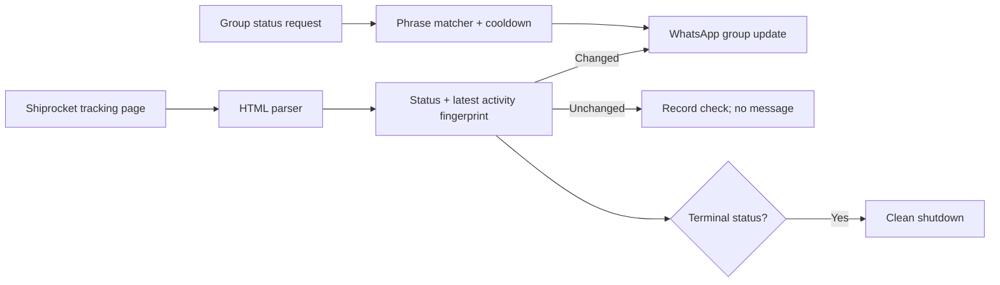

# Shiprocket WhatsApp Group Bot — Portfolio Case Study

## Category

**AI & Automation · Business Systems · Operations Enablement**

## The problem

Shipment updates often live on carrier tracking pages while customers, teams, or families coordinate in WhatsApp. Repeated manual checks create unnecessary effort, and broadcasting every poll would create noise.

## Solution

I built a Node.js operations bot that monitors a configured Shiprocket tracking page, extracts the latest shipment information, and sends a WhatsApp group update only when the status or newest tracking activity changes. It can also recognize common status questions in the group and reply with a current snapshot, subject to a cooldown.

## How it works

## Verified implementation evidence

- **5 automated tests pass** across Shiprocket parsing, status-request matching, and terminal-status protection.
- The runtime design waits for a WhatsApp delivery acknowledgement before treating an outbound update as sent.
- A local authenticated session and acknowledged group update were observed during development; personal group names, tracking IDs, and logs are intentionally excluded from the public repository.
- Configuration, WhatsApp authentication state, shipment state, and logs are excluded from Git to prevent publishing private operational data.

## Business value

| Need | Design decision | Expected operational impact |
| --- | --- | --- |
| Avoid repetitive tracking checks | Poll a single source on a configurable interval | Less manual follow-up work |
| Prevent alert fatigue | Fingerprint status plus newest activity | Updates only when the shipment materially changes |
| Serve questions where people already work | Recognize common WhatsApp status requests | Faster self-service status answers |
| End work when it is complete | Detect delivered/terminal states and stop | Avoids needless polling and process noise |
| Keep the service available | Windows startup and PM2 deployment options | Supports continuous operation beyond a single terminal session |

## Metrics to track in production

- **Time-to-alert:** time from carrier status change to group notification.
- **Duplicate-suppression rate:** checks completed without sending a redundant update.
- **Delivery reliability:** percentage of messages receiving a WhatsApp acknowledgement.
- **Self-service resolution:** percentage of group status questions answered automatically.
- **Availability:** successful checks and bot uptime by week.

## Recommendation

Run a two-week pilot with the metrics above. Use the results to tune the polling interval, request phrases, and cooldown. Keep the current human-readable WhatsApp message format, then add an operations dashboard only if the pilot demonstrates enough volume to justify it.

## Technology

Node.js · whatsapp-web.js · Puppeteer · Shiprocket tracking-page parsing · JSON state persistence · PowerShell startup automation · PM2 · Node test runner

## Responsible implementation note

WhatsApp group messaging is implemented through WhatsApp Web automation because the official WhatsApp Business Cloud API does not support group messaging. The project documents this constraint and recommends using a dedicated WhatsApp account.
